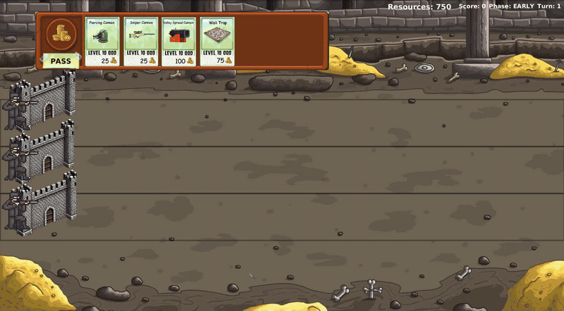
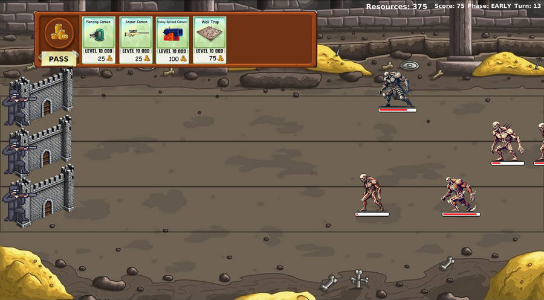
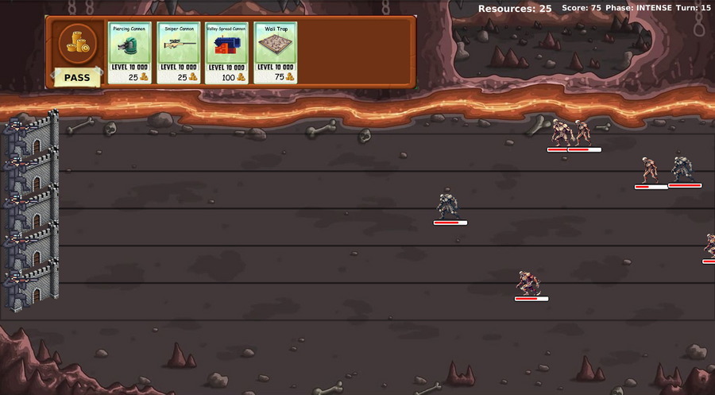
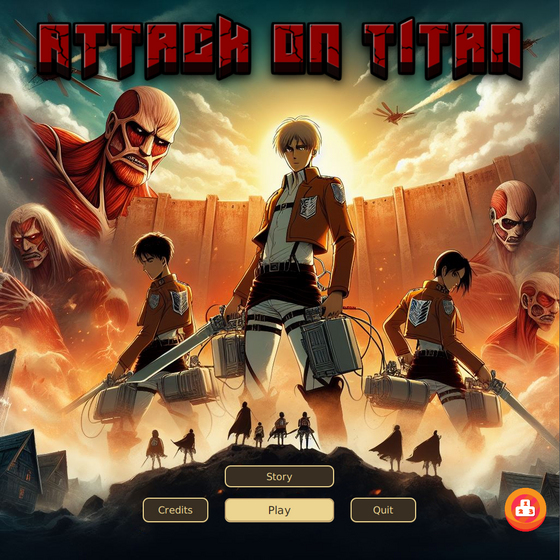
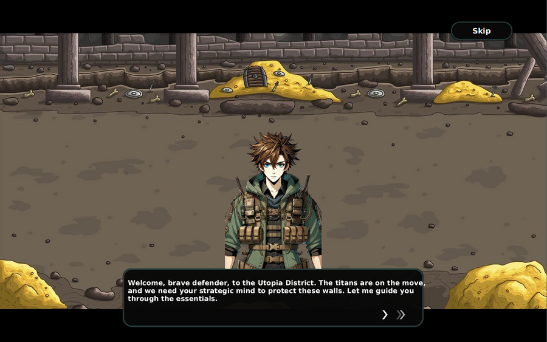
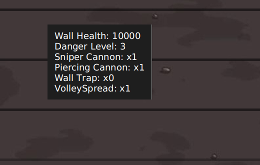

<div align="center">

# ⚔️ Attack on Titan: Utopia

**A turn-based tower-defense game in Java and JavaFX: hold the walls of Utopia District against waves of titans, with a story mode, an interactive tutorial, two difficulty modes and an online leaderboard.**


[](https://danehab.itch.io/attack-on-titan-survival-game)



<sub>Easy mode, sped up 4×</sub>

</div>

---

## The game

Titans spawn on the right and walk along their lane towards the walls on the left. Every turn you either **buy one weapon and deploy it to a lane** or **pass**. Then every titan moves, every weapon fires, and the titans that have reached a wall attack it. Defeating titans gives you resources and score. The game ends when every lane's wall has fallen.

The battle gets harder over time. It moves from the **EARLY** phase to **INTENSE** at turn 15 and **GRUMBLING** at turn 30, and after that the number of titans per turn doubles every 5 turns. New titans always go to the least dangerous lane, so no lane stays quiet for long.

| Easy (3 lanes, 750 resources) | Hard (5 lanes, 625 resources) |
|:---:|:---:|
|  |  |

## Features

| Main menu | Interactive tutorial |
|:---:|:---:|
|  |  |

- **Main menu** with Story, Play, Credits, Quit and a leaderboard button, plus theme music and a custom animated cursor.
- **Story mode**: a short cut-scene with voiced dialogue between Eren, Mikasa and Armin.
- **Interactive tutorial** that highlights each part of the screen as it explains it (the walls, the HUD, the lanes, the weapon shop). Afterwards you can ask about the titans or the weapons, repeat the instructions, or start playing. It can be skipped.
- **Two difficulty modes** with their own maps: Easy (3 lanes) and Hard (5 lanes, fewer starting resources).
- **Weapon shop** with cards for every weapon. Clicking a card shows its stats, and the lanes turn **green** when you can afford it and **red** when you can't.
- **Lane details on hover**: wall health, danger level and how many of each weapon are deployed.
  <br>
- **Animated titans with health bars**, and a HUD with resources, score, phase and turn.
- **Game over → online leaderboard**: you enter a name, the score is saved to a **Firebase Realtime Database**, and the leaderboard shows the top 5 together with your own rank. Names must be unique.

### Titans

| Titan | HP | Damage | Speed | Notes |
|---|---:|---:|---:|---|
| Pure | 100 | 15 | 10 | The basic titan; dangerous in numbers |
| Abnormal | 100 | 20 | 15 | Attacks twice per turn |
| Armored | 200 | 85 | 10 | Takes only 25% of incoming damage |
| Colossal | 1000 | 100 | 5 | Speeds up by 1 after every move |

### Weapons

| Weapon | Price | Damage | Targets |
|---|---:|---:|---|
| Piercing Cannon (Anti-Titan Shell) | 25 | 10 | The 5 closest titans in the lane |
| Sniper Cannon (Long Range Spear) | 25 | 35 | The closest titan |
| Volley Spread Cannon (Wall Spread Cannon) | 100 | 5 | Every titan between distance 20 and 50 |
| Wall Trap (Proximity Trap) | 75 | 100 | A titan that has reached the wall |

Titan and weapon stats are loaded from [`resources/titans.csv`](resources/titans.csv) and [`resources/weapons.csv`](resources/weapons.csv).

---

## How it is built

```
src/game/
├── engine/        game logic: Battle, Lane, Wall, titans, weapons, factory, CSV loader, exceptions
├── gui/           JavaFX front end (about 4,800 lines) and all images, sounds, fonts and cursors
│   ├── Main.java          main menu, credits, quit dialog
│   ├── Instructions.java  story mode with voiced dialogue
│   ├── Rules.java         interactive tutorial and the titan / weapon guides
│   ├── Modee.java         difficulty selection
│   ├── ALfinale.java      Easy mode battle screen
│   ├── HARD.java          Hard mode battle screen
│   ├── GAMEOVER.java      game-over screen and name entry
│   └── LeaderboardUI.java top 5 plus the player's own rank
└── leaderboard/   FirebaseService (REST calls with Apache HttpClient and Gson) and Player
```

- **Engine.** Every lane keeps its titans in a `PriorityQueue` ordered by distance to the wall, so each weapon can find its targets quickly. Lanes are also kept in a priority queue by danger level, so the battle can send new titans to the least dangerous lane. Weapons are bought through a `WeaponFactory`, which throws an `InsufficientResourcesException` when you can't afford them.
- **GUI.** Each battle screen draws the walls, lanes, titans and health bars, and refreshes them from the engine's state after every turn. Titan sprites are positioned from each titan's distance.
- **Leaderboard.** Scores are stored in Firebase through its REST API. Before saving a score, the game checks that the name is not already taken. To show the leaderboard, it fetches all scores, sorts them and works out the player's rank.

The `engine` package is the Milestone 2 model solution given to all students in the course. Our team designed and built everything in `gui` and `leaderboard` on top of it.

---

## Run it

You need **JDK 17 or newer** and **Maven**. Maven downloads JavaFX and the other libraries.

```console
$ git clone https://github.com/DanEhab/attack-on-titan-utopia.git
$ cd attack-on-titan-utopia
$ mvn javafx:run
```

- The layout is designed for a **1920 × 1080** screen.
- The leaderboard needs an internet connection. Everything else works offline.
- You can also download a ready-to-play build from [itch.io](https://danehab.itch.io/attack-on-titan-survival-game).

---

## Looking back

- **Duplicated screens.** `ALfinale` (Easy) and `HARD` share most of their code. A single battle screen that takes the number of lanes and the map as parameters would remove almost half of the GUI code.
- **Fixed sizes.** Positions and sizes are fractions of the screen size (for example `width / 19.2`), which looks right at 1920 × 1080 but not on other screens. JavaFX layout panes and bindings would scale properly.
- **The leaderboard trusts the client.** The game writes scores straight to the database, so anyone with the URL can change them. A real release would put a small server or Firebase security rules in front of the database.

---

## Team & course

Built for **CSEN401 Computer Programming Lab**, German University in Cairo, Spring 2024.

**Team:** Daniel Ehab (team lead) · Mina Hossam · George Samy

<sub>This is a non-commercial fan project made for a university course. *Attack on Titan* and its characters, artwork and music belong to their respective owners.</sub>
